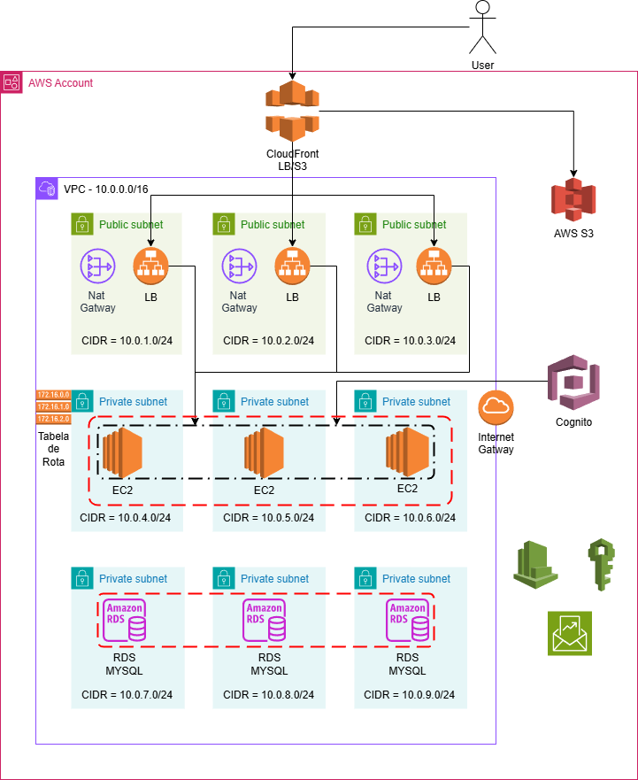

# Infraestrutura AWS com Terraform

**Projeto acadêmico de Infraestrutura como Código (IaC), desenvolvido no Santander Coders / Ada Tech.**

Definição de uma infraestrutura AWS para um cenário de e-commerce de produtos digitais, reunindo rede, computação, banco de dados, armazenamento e distribuição de conteúdo em configurações Terraform versionadas.

O foco deste repositório é o provisionamento da infraestrutura. Ele não entrega, por si só, uma aplicação de e-commerce funcional nem instala automaticamente a aplicação nas instâncias EC2.

> **Estado do projeto:** configuração em revisão técnica. Os recursos abaixo estão declarados no código; isso não comprova implantação bem-sucedida, disponibilidade dos serviços ou validação em produção.

## Objetivos de aprendizagem

- Representar recursos AWS em código e controlar sua evolução com Git.
- Organizar uma VPC em camadas de rede distribuídas por três zonas de disponibilidade.
- Relacionar computação, balanceamento de tráfego, armazenamento e distribuição de conteúdo.
- Trabalhar com tabelas de rotas, Security Groups e dependências entre recursos.
- Utilizar um backend S3 para armazenar o estado do Terraform.

## Arquitetura



O desenho apresenta a proposta acadêmica. Os arquivos Terraform são a referência para identificar os recursos efetivamente declarados; o diagrama deve acompanhar as revisões do código.

| Camada | Recursos declarados | Escopo atual |
| --- | --- | --- |
| Rede | VPC e nove sub-redes | Três sub-redes públicas, três privadas e três destinadas ao banco, distribuídas por três zonas. |
| Conectividade | Internet Gateway, três NAT Gateways, três Elastic IPs e tabelas de rotas | Rotas públicas para o Internet Gateway e rotas de saída das sub-redes privadas pelos NAT Gateways. |
| Computação | Três instâncias EC2 | Instâncias fixas nas sub-redes públicas; não há Auto Scaling Group. |
| Balanceamento | Application Load Balancer, listener HTTP e Target Group | Encaminhamento para as três instâncias na porta 80, com health check no caminho `/`. |
| Banco de dados | DB Subnet Group e recurso `aws_rds_cluster` com engine MySQL | Configuração de banco declarada; parâmetros e compatibilidade precisam de revisão antes da implantação. |
| Armazenamento | Bucket S3, bloqueio de acesso público e política de acesso | Um bucket de conteúdo; não há envio automático dos arquivos da aplicação. |
| Distribuição | Duas distribuições CloudFront | Uma com origem no S3 e outra com origem no balanceador. |
| Controle de tráfego | Dois Security Groups | Regras para HTTP e acesso ao MySQL; a associação do grupo ao balanceador precisa de correção. |
| Estado Terraform | Backend S3 | Aponta para um bucket externo, que precisa existir e estar acessível. |

A distribuição por zonas é uma característica da configuração. Não representa garantia de alta disponibilidade da aplicação.

## Tecnologias

- **Terraform / HCL:** descrição e gerenciamento da infraestrutura.
- **AWS Provider:** `hashicorp/aws`, fixado em `5.75.0` no `main.tf`.
- **Amazon VPC, EC2, S3, RDS e CloudFront.**
- **Elastic Load Balancing, NAT Gateway e Security Groups.**
- **Git:** versionamento das configurações.

## Estrutura do repositório

Os arquivos `.tf` da pasta raiz compõem um único módulo Terraform. A separação por arquivo facilita a leitura; não são módulos independentes.

| Arquivo | Responsabilidade |
| --- | --- |
| `main.tf` | Declara o provedor requerido e configura o backend S3. |
| `provider.tf` | Define a região e as tags padrão do provedor AWS. |
| `variable.tf` | Define as variáveis de região, CIDR, zonas, AMI e tipo de instância. |
| `vpc.tf` | Declara a VPC e as nove sub-redes. |
| `gateway.tf` | Declara o Internet Gateway e os três NAT Gateways. |
| `eip.tf` | Declara os Elastic IPs usados pelos NAT Gateways. |
| `route.tf` | Define tabelas de rotas e suas associações às sub-redes. |
| `ec2.tf` | Declara as três instâncias EC2. |
| `lb.tf` | Define o ALB, o listener, o Target Group e os registros das instâncias. |
| `rds.tf` | Define o grupo de sub-redes e a configuração do banco. |
| `s3.tf` | Define o bucket de conteúdo, o bloqueio de acesso público e sua política. |
| `cloudfront.tf` | Define as distribuições com origens no S3 e no ALB. |
| `locals.tf` | Contém fontes de dados e a política de acesso ao bucket. |
| `securtygroups.tf` | Define os Security Groups. O nome corresponde ao arquivo atual do repositório. |
| `atividade.drawio` | Arquivo editável do desenho da arquitetura. |
| `projeto.png` | Imagem do diagrama. |

## Pré-requisitos

Para inspecionar e validar a configuração:

- Git.
- Terraform compatível com o AWS Provider declarado. O projeto ainda não especifica `required_version` para o Terraform.
- Acesso à rede para baixar o provedor durante a inicialização.

Para planejar ou provisionar recursos, também são necessários:

- Conta AWS e autenticação configurada fora dos arquivos versionados.
- Permissões para os recursos envolvidos e para o backend de estado.
- Bucket S3 de estado previamente criado, com configuração revisada.
- Revisão dos pontos pendentes descritos abaixo.

## Executar a validação local

### 1. Obter o código

```bash
git clone https://github.com/viniciuscaol/proejetofinal-sciac.git
cd proejetofinal-sciac
```

### 2. Conferir e ajustar a formatação

```bash
terraform fmt -check -recursive
```

Caso existam diferenças de formatação:

```bash
terraform fmt -recursive
```

### 3. Inicializar sem acessar o backend remoto

Em um checkout novo, execute:

```bash
terraform init -backend=false
terraform validate
```

Essa etapa não cria recursos na AWS e não exige configurar o bucket remoto. A inicialização baixa os componentes necessários. A validação verifica a configuração e os esquemas do provedor, mas não comprova permissões AWS, disponibilidade de uma AMI, compatibilidade operacional do RDS ou funcionamento da aplicação.

O resultado da validação deve ser registrado após a execução. Este README não afirma que os comandos passaram.

## Configuração do ambiente

### Variáveis existentes

| Variável | Valor padrão | Observação |
| --- | --- | --- |
| `region` | `us-east-1` | Deve ser coerente com as zonas e a AMI. |
| `vpc-cidr` | `10.0.0.0/16` | Os CIDRs das sub-redes estão definidos diretamente no código; alterar apenas esta variável não os recalcula. |
| `availability_zone` | `us-east-1a`, `us-east-1b`, `us-east-1c` | A configuração atual acessa três posições dessa lista. |
| `ec2_ami` | ID definido em `variable.tf` | Confirme disponibilidade, região e arquitetura antes de usar. |
| `instance_type` | `t2.micro` | Ajuste conforme a AMI e a necessidade do laboratório. |

Arquivos locais `.tfvars`, quando utilizados, devem ficar fora do versionamento se contiverem dados específicos do ambiente ou informações sensíveis.

### Backend S3

O bloco `backend "s3"` em `main.tf` aponta para um bucket de estado já nomeado no código, na região `us-east-1`. Esse bucket **não é criado** pelos recursos de conteúdo definidos em `s3.tf`.

Antes da inicialização com backend, ajuste a configuração para um bucket sob seu controle e confira permissões e proteção do estado. Não migre nem reutilize o estado de outro ambiente sem revisar seu conteúdo e seu vínculo com os recursos existentes.

Depois das correções técnicas e da preparação do backend:

```bash
terraform init -reconfigure
terraform plan
```

Se este checkout já utiliza outro backend com estado existente, revise a migração separadamente antes de executar a reconfiguração. O planejamento pode consultar a AWS e exige autenticação. A aplicação das mudanças deve ocorrer somente após a análise do plano e dos custos.

## Limitações e revisões pendentes

### Correções antes do provisionamento

- **Credencial do banco:** remover a senha definida diretamente no código e adotar um mecanismo adequado de fornecimento ou gerenciamento de credenciais. Se o valor versionado tiver sido utilizado em um ambiente real, substituí-lo nesse ambiente. A marcação `sensitive` oculta valores em algumas saídas, mas não impede, por si só, sua presença no estado.
- **RDS:** conferir a compatibilidade entre `aws_rds_cluster`, engine, classe de instância, armazenamento e região. O código não deve ser descrito como uma instância Single-AZ já validada.
- **Balanceador:** o ALB referencia atualmente o Security Group destinado ao RDS. Criar e associar um grupo adequado ao listener e revisar o caminho de tráfego ALB → EC2 → banco.
- **Rotas privadas:** revisar o uso de `gateway_id` nas rotas que referenciam NAT Gateways, conforme o esquema do provedor.
- **S3 e CloudFront:** alinhar o mecanismo de acesso à origem. A distribuição usa Origin Access Identity (OAI), enquanto a política do bucket está estruturada para o principal do serviço CloudFront com condição de distribuição.
- **Aplicação nas EC2:** incluir instalação/configuração de um servidor ou aplicação de demonstração para permitir resposta ao health check. Não há bootstrap da aplicação declarado em `ec2.tf`.
- **Portabilidade:** revisar AMI, nomes de buckets, região, zonas e CIDRs antes de executar em outra conta.

### Recursos ainda não implementados

- Auto Scaling Group e políticas de escalabilidade.
- Autenticação de usuários com Amazon Cognito.
- Alarmes e dashboards de aplicação no CloudWatch.
- Alertas de orçamento com AWS Budgets.
- Pipeline de validação e entrega no GitHub Actions.
- Instalação da aplicação e publicação automática de conteúdo no S3.

A presença desses serviços na proposta original não significa que estejam provisionados pelo repositório.

## Custos e ciclo de vida

O laboratório declara recursos com cobrança, incluindo três NAT Gateways, ALB, EC2, endereços IPv4 públicos e RDS com armazenamento provisionado. Não há estimativa de custo validada nem garantia de cobertura pela camada gratuita.

Antes de provisionar, revise a configuração e estime o custo no [AWS Pricing Calculator](https://calculator.aws/). NAT Gateways e banco de dados merecem atenção mesmo em ambientes sem tráfego significativo.

Para avaliar a remoção de um laboratório que você efetivamente criou:

```bash
terraform plan -destroy
```

Revise o plano antes de executar qualquer remoção. No código atual, o bucket de conteúdo usa `force_destroy = true` e o banco está sem proteção contra exclusão. Portanto, confirme a preservação dos dados e a estratégia de snapshot/backup antes de remover recursos. O bucket externo de estado não faz parte dos recursos declarados neste projeto.

## Próximas entregas

- [ ] Corrigir os pontos técnicos identificados e registrar o resultado de `terraform validate`.
- [ ] Definir uma versão compatível do Terraform e versionar `.terraform.lock.hcl`.
- [ ] Adicionar validação automática em pull requests.
- [ ] Incluir exemplos de configuração sem credenciais.
- [ ] Atualizar o diagrama conforme a implementação revisada.
- [ ] Adicionar outputs úteis para identificar os recursos provisionados.
- [ ] Documentar um teste controlado de implantação, conectividade e remoção.

## Autor e contexto

**Vinicius Caldas Oliveira** — projeto final de IaC do Santander Coders / Ada Tech.

- [GitHub](https://github.com/viniciuscaol)
- [LinkedIn](https://www.linkedin.com/in/viniciuscaol/)

## Licença

Distribuído sob a licença [MIT](./LICENSE).
